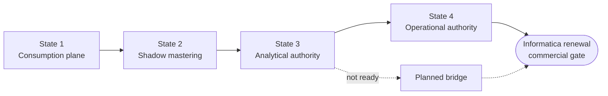

# Composable MDM on Snowflake — Informatica MDM migration kit

A vendor-neutral blueprint, architecture diagrams, and a **tested reference implementation** for organizations that want to move master data management off Informatica MDM and onto Snowflake. The aim is to keep the behavior that matters, not to clone the hub.

> Snowflake becomes the system of **mastering**. Kafka stays the system of **movement**. Operational applications stay systems of **record**. Agents become governed **consumers**.

## What's inside

| Path | Contents |
|---|---|
| [`docs/BLUEPRINT.md`](docs/BLUEPRINT.md) | The migration guide: options, target architecture, mastering model, latency classes, Java decomposition, stewardship, AI guardrails, transition states, waves and gates (expressed in programme months), parallel run, cutover, privacy/erasure, team, RACI, ADRs, risks, POC scope |
| [`docs/ARCHITECTURE.md`](docs/ARCHITECTURE.md) | 10 Mermaid diagrams (current state, target, Java decomposition, transition states and waves, state machine, command path/unmerge, AI/agents, CoCo factory, latency classes, object model). Rendered SVG/PNG in [`docs/diagrams`](docs/diagrams) |
| [`docs/IMPLEMENTATION.md`](docs/IMPLEMENTATION.md) | How the reference implementation maps to each blueprint requirement, how to run it, results, hardening checklist |
| [`docs/REFERENCE_REVIEW.md`](docs/REFERENCE_REVIEW.md) | Review of a public Snowflake-native MDM project, plus a check of the latest Snowflake features this design uses (verified Nov 2026) |
| [`implementation/`](implementation) | SQL (Dynamic Tables, SQL procedures, Hybrid Table, semantic view, triggered task, Cortex AI), a Streamlit stewardship console, a golden-dataset generator and a deploy/test runner |
| [`templates/`](templates) | Capability record, Java event assessment, cutover evidence pack, open decisions register |
| [`prompts/`](prompts) | Cortex Code prompt patterns for inventory, behavioral extraction, Java decomposition, build and reconciliation |

## The approach in one picture



| Wave | Scope | Months (example: renewal at M10) |
|---|---|---|
| 0 | Platform foundation, inventory, Gate 1 decisions | M1–M2 |
| 1 | First domain: POC → shadow → analytical authority | M2–M5 |
| 2 | Remaining B2B domains | M4–M7 |
| 3 | PII-heavy domains (erasure, consent) | M5–M8 |
| 4 | Operational write-back; retire Data Director | M6–M9 |
| 5 | Retirement and hardening | M9–M11 |

## Quick start (reference implementation)

```bash
pip install snowflake-connector-python
cd implementation
python run.py all --connection <name> --database <DB> --schema MDM_DEMO --warehouse <WH>
```

Last run: **29/29 checks passed** ([results](implementation/tests/RESULTS.md)). On a synthetic labelled dataset: 0 false merges, every true duplicate either auto-linked or routed to a steward, ledger-based unmerge after post-merge updates, erasure with late-event suppression, and AI recommendations that cannot change mastered state.

## Non-negotiables

1. Identity resolution is separate from survivorship.
2. Every merge is traceable and reversible; master IDs are stable.
3. No PII in the decision ledger; erasure is a governed command.
4. Sub-second reads come from a serving layer, never the mastering pipeline.
5. AI recommends; humans and versioned policy decide.

## Status and caveats

- Feature status was checked against Snowflake documentation in November 2026. The Openflow Connector for Snowflake to Kafka (outbound) is **Preview**. Hybrid Tables are GA on AWS and Azure and in Preview on GCP. Re-check before each gate.
- The reference implementation is a POC starting point for one domain, not a production MDM product. See the hardening checklist in `docs/IMPLEMENTATION.md`.
- The Streamlit console is a starter; it has been syntax-checked but not deployed as part of the automated tests.
