# Architecture diagrams

All diagrams are Mermaid and render natively on GitHub. Figure numbers are referenced from [BLUEPRINT.md](BLUEPRINT.md); objects in **bold mono** exist in the [reference implementation](../implementation).

---

## Figure 1 — Current-state Informatica MDM landscape

Java handlers are the least-documented component and usually carry the hardest semantics.

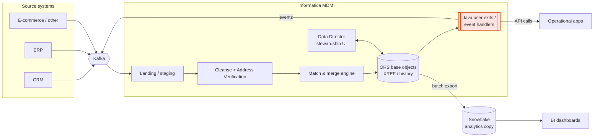

---

## Figure 2 — Target composable MDM on Snowflake

Snowflake = system of mastering · Kafka = system of movement · apps = systems of record · agents = governed consumers.

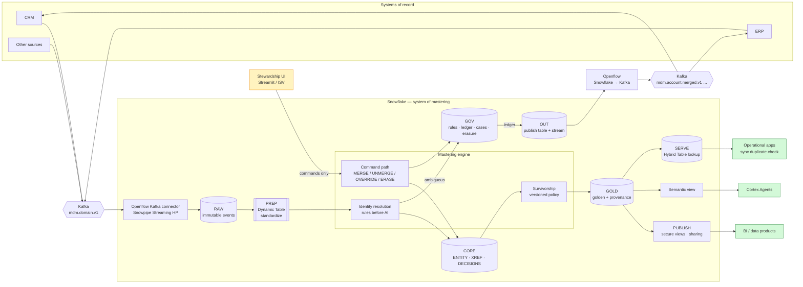

---

## Figure 3 — Decomposing a POST_MERGE Java handler

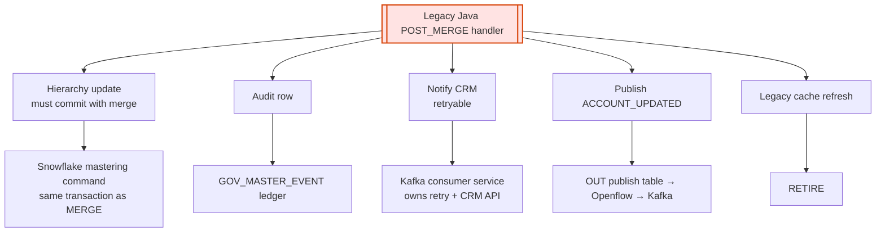

---

## Figure 4 — Transition states and authority progression

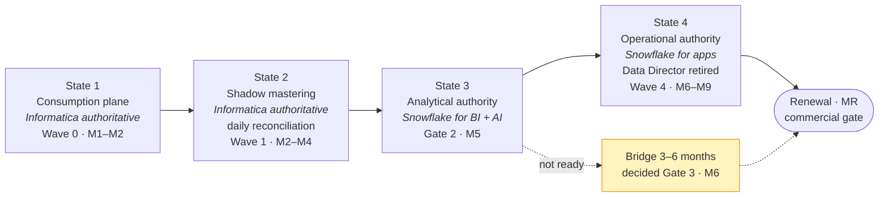

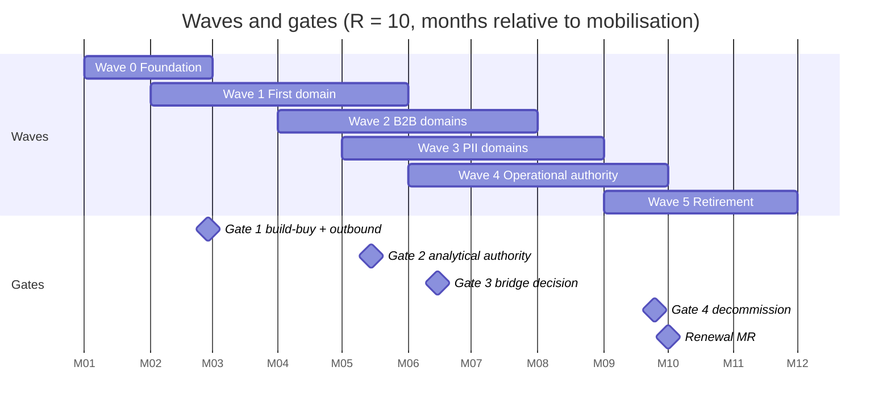
*(The Gantt uses a placeholder year; read the axis as programme months M1…M12.)*

---

## Figure 5 — Master record state machine

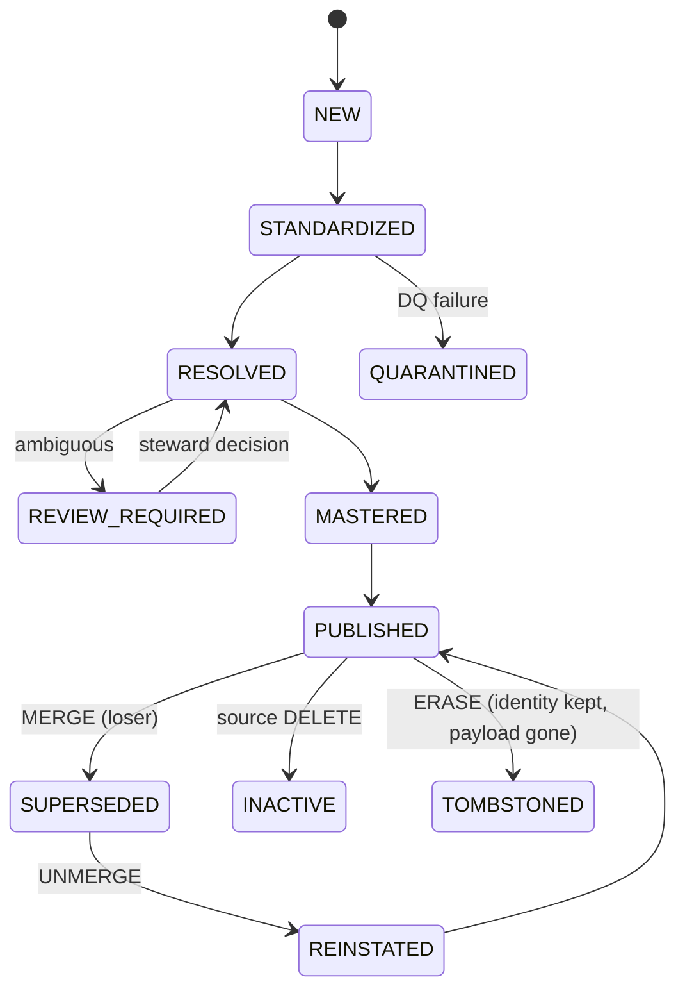

---

## Figure 6 — Stewardship command path and unmerge

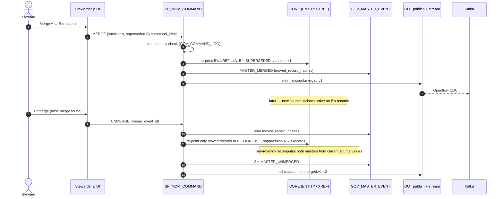

---

## Figure 7 — AI and agent architecture (AI recommends, policy decides)

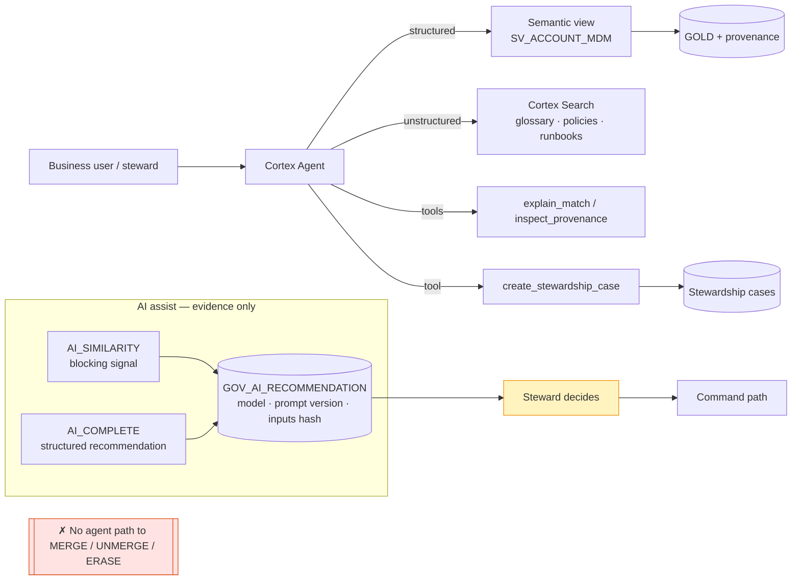

---

## Figure 8 — CoCo-assisted migration factory

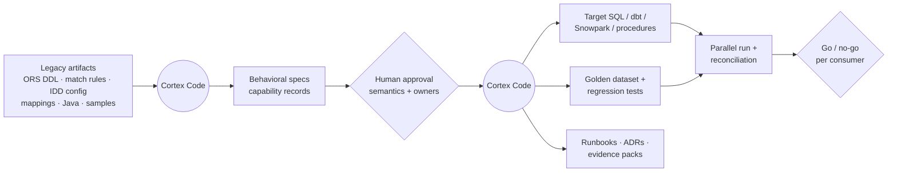

---

## Figure 9 — Latency classes and where each is served

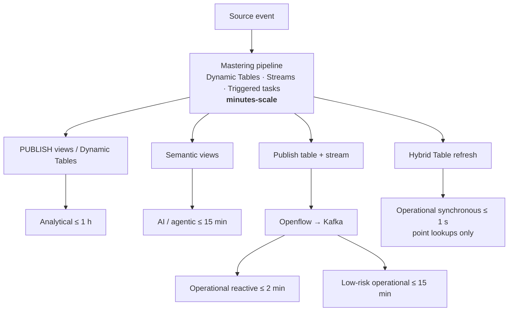

---

## Figure 10 — Reference implementation objects

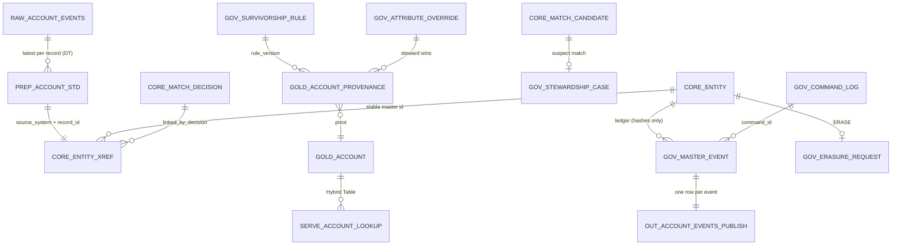
